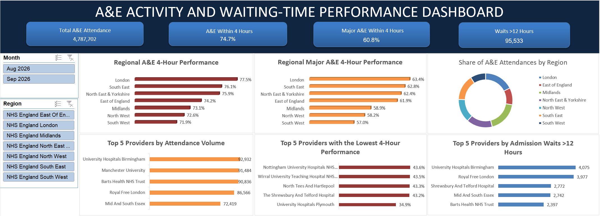

# Data Analytics Project Portfolio

# Project 1

**Title:** A&E Activity and Four-Hour Performance Dashboard — England, August–September 2026

**Tools Used:** Microsoft Excel (Power Query Editor, structured tables, PivotTables, PivotCharts, formulas and slicers)

**Project Description:** I developed an interactive dashboard using NHS England provider-level A&E data for August and September 2026. I prepared the data in a provider-by-month table and used PivotTables and PivotCharts to compare attendance volumes, four-hour performance and admission waits across regions and providers. The month and region slicers allow users to explore different selections. Regional performance rates are calculated from summed attendance counts, rather than by averaging provider percentages.

**Key findings:**

- **Regional performance follows a consistent pattern:** London ranks highest and the South West lowest for both all-department and major A&E four-hour performance. This suggests that the regional differences are not limited to one department type.

- **Major A&E performance is lower in every region:** The gap between major A&E and all-department performance ranges from 12.3 to 14.9 percentage points. The widest gap is in the South West, indicating that the difference is not just a national average effect.

- **One provider stands out among the lowest performers:** University Hospitals Plymouth’s major A&E four-hour rate is 8.3 percentage points below the next-lowest provider shown. This flags a result for further investigation; the dashboard alone cannot explain its cause.

- **High activity and high wait counts overlap:** Four of the five providers with the highest attendance volumes also appear among the five with the most admission waits over 12 hours. These are absolute counts, so comparing wait rates against provider activity would be needed to assess relative burden.

**Dashboard Overview:** KPI cards summarize overall activity, four-hour performance and waits over 12 hours. Regional bar charts compare all-department and major A&E performance, while a doughnut chart shows the regional share of attendances. Provider charts highlight the highest attendance volumes, the lowest major A&E four-hour rates and the largest counts of admission waits over 12 hours. Month and region slicers let users filter the dashboard. The results describe the selected two-month period and are not adjusted for differences in provider size, service mix or patient complexity.

[A & E Dashboard File](AE-by-provider-B5lUR.xlsx)

# Project 2

**Title:** [Employee Workforce and Salary Analysis with SQL](./employee_db.sql)

**Tools Used:** Microsoft SQL Server, including joins, aggregate functions, filters, string and date functions, a CTE and window functions.

**Project Description:** This project uses Microsoft SQL Server to explore a relational HR dataset containing employee records and position details. I joined the tables by employee ID and wrote queries to answer practical workforce questions, including how employees are distributed across departments and gender groups, which employees hold managerial roles, and how salaries vary across the records. The queries use filtering, aggregation, sorting, string functions and ranking to make the data easier to examine and report which shows how SQL can help organise employee information and support routine HR analysis.

**Key findings:**

- Joining the tables by employee ID brings employee, department, role and salary information together for analysis.
- Department and gender counts provide ways to examine workforce composition, while date filters allow comparisons across selected employee groups.
- Salary filters and ranking queries help identify employees within a chosen pay band and those at the upper and lower ends of the salary distribution.
